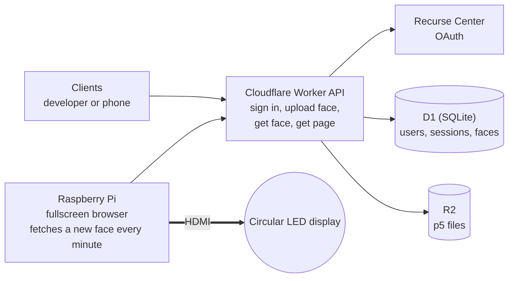
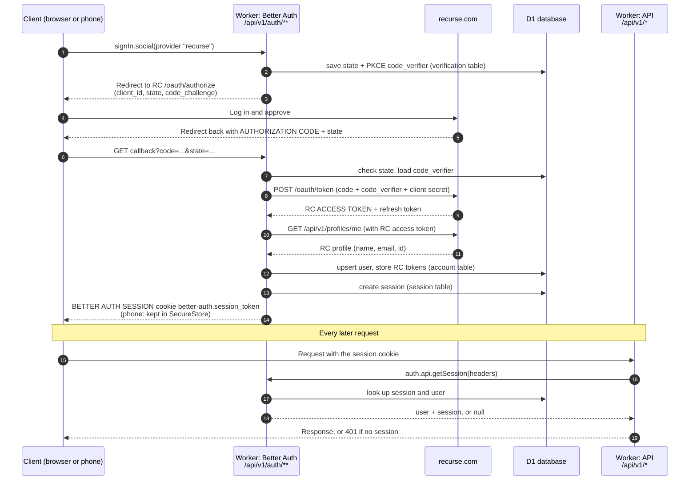

# Circular LED Server

A Cloudflare Worker API that stores circular p5.js clock faces, plus a Raspberry Pi that shows them on a round LED display over HDMI.

## Architecture

One Worker, and it is only an API: sign in, upload a face, fetch a face, fetch the page. The Raspberry Pi is a thin display. Its browser asks the API for a new face every minute. Clock is the theme, but a face can be any circular p5.js sketch.



Sign-in uses Recurse Center OAuth through Better Auth, the same setup as Batchmate. Data model and open questions are in the [design doc](docs/design.md).

## Writing a face

A face is one p5.js sketch for a round display. The theme is a clock, but a face can be anything. Using time is optional: a face that ignores it is still valid.

The display page gives every sketch a global `face` object. It is always up to date, so just read it in `draw()`.

| Property | Meaning |
| --- | --- |
| `face.size` | Canvas width and height in pixels. The canvas is square, and the round display is the circle inside it. |
| `face.radius` | `face.size / 2`. |
| `face.hours` | 0 to 23. |
| `face.minutes` | 0 to 59. |
| `face.seconds` | 0 to 59. |
| `face.hourAngle` | Hour hand angle in radians. 0 is 12 o'clock and it grows clockwise. Moves smoothly with the minutes. |
| `face.minuteAngle` | Minute hand angle, same rules. |
| `face.secondAngle` | Second hand angle, same rules. |

Example: a clock with two hands. At 6 p.m. the hour hand points straight down and the minute hand points straight up.

```js
function setup() {
  createCanvas(face.size, face.size);
}

function draw() {
  background(0);
  translate(face.radius, face.radius);
  stroke(255);
  noFill();
  circle(0, 0, face.size - 4);

  push(); rotate(face.hourAngle);   strokeWeight(8); line(0, 0, 0, -face.radius * 0.5); pop();
  push(); rotate(face.minuteAngle); strokeWeight(4); line(0, 0, 0, -face.radius * 0.8); pop();
}
```

How this is implemented is in the [design doc](docs/design.md#face-contract).

## Run it locally

No Cloudflare or Recurse account is needed for local work. A fake Recurse server stands in for the real one.

```sh
npm install
cp .dev.vars.example .dev.vars   # then fill in BETTER_AUTH_SECRET (openssl rand -base64 32)
npm run db:migrate:local         # create the local database
npm run seed:local               # load the example faces from seed/faces
npm run mock-rc                  # terminal 1: fake Recurse on :9999
npm run dev                      # terminal 2: the Worker on :8787
```

Then open http://localhost:8787 (home, sign in, upload) or http://localhost:8787/display (what the Pi shows). Test options on the display page: `?every=5` swaps every 5 seconds, `?time=18:00` freezes the clock, `?tz=America/New_York` sets the timezone. `npm test` runs the unit tests.

## How sign-in works (modeled on Batchmate)

Recurse never hands the client a session token. Recurse issues an OAuth access token to the server, and Better Auth creates its own session and gives the client that.



Three different credentials show up in this flow. They are not interchangeable. See [Code vs tokens](docs/design.md#code-vs-tokens).

## Pieces

| Piece | Role |
| --- | --- |
| Clients | A developer or a phone. Sign in, write and preview faces in a live editor, upload them. |
| Worker API | The only backend. Auth (Better Auth + Recurse OAuth), upload, get a face, serve the page. |
| D1 (SQLite) | Users, sessions, and a faces table with each face's R2 path. |
| R2 | The p5 source files. |
| Raspberry Pi | A fullscreen browser. Every minute it asks the API for a new face and shows it. |

## Viewing the docs

`npm run docs` builds an HTML page from the markdown files, with Mermaid diagrams drawn, and opens it in your browser.
