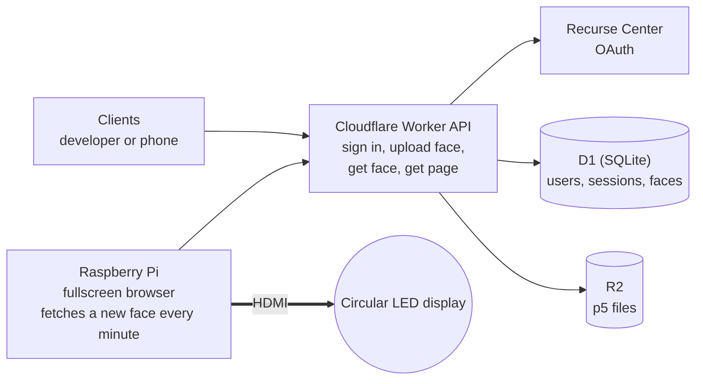
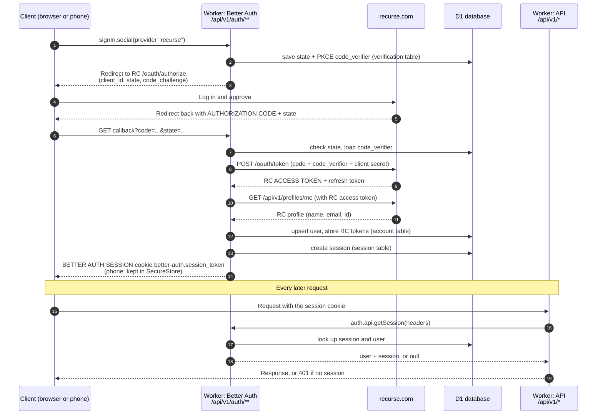

# Circular LED Server

A Cloudflare Worker API that stores circular p5.js clock faces, plus a Raspberry Pi that shows them on a round LED display over HDMI.

**Live at https://clock.recurse.com/** (display page: https://clock.recurse.com/display)

What is left to do: [docs/todo.md](docs/todo.md).

<p align="center"></p>

## Architecture

One Worker, and it is only an API: sign in, upload a face, fetch a face, fetch the page. The Raspberry Pi is a thin display. Its browser asks the API for a new face every minute. Clock is the theme, but a face can be any circular p5.js sketch.



Sign-in uses Recurse Center OAuth through Better Auth, the same setup as Batchmate. Data model and open questions are in the [design doc](docs/design.md).

## Writing a face

Open the editor at https://clock.recurse.com/editor. Click **+ New face** on the home page and you get working example code (`setup()` and `draw()` already written) next to a live round preview. Edit, watch the preview, then Save. The preview runs in the same sandbox as the display. Signing in is only needed to save.

**Who can do what** (any signed-in Recurse user):
- upload a face, and edit their own faces;
- **pause** (⏸) or resume any face. A paused face stays saved but is skipped by the display rotation;
- **delete** any face. This is permanent and affects everyone.

A face is one p5.js sketch for a round display. The theme is a clock, but a face can be anything. Using time is optional: a face that ignores it is still valid.

The display page gives every sketch a global `face` object. It is always up to date, so just read it in `draw()`.

| Property | Meaning |
| --- | --- |
| `face.size` | Canvas width and height in pixels. The canvas is square, and the round display is the circle inside it. |
| `face.radius` | `face.size / 2`. |
| `face.hours` | 0 to 23. |
| `face.minutes` | 0 to 59. |
| `face.seconds` | 0 to 59. |
| `face.hourAngle` | Hour hand angle in radians. 0 is 12 o'clock and it grows clockwise. Moves smoothly with the minutes. |
| `face.minuteAngle` | Minute hand angle, same rules. |
| `face.secondAngle` | Second hand angle, same rules. |

Example: a clock with two hands. At 6 p.m. the hour hand points straight down and the minute hand points straight up.

```js
function setup() {
  createCanvas(face.size, face.size);
}

function draw() {
  background(0);
  translate(face.radius, face.radius);
  stroke(255);
  noFill();
  circle(0, 0, face.size - 4);

  push(); rotate(face.hourAngle);   strokeWeight(8); line(0, 0, 0, -face.radius * 0.5); pop();
  push(); rotate(face.minuteAngle); strokeWeight(4); line(0, 0, 0, -face.radius * 0.8); pop();
}
```

How this is implemented is in the [design doc](docs/design.md#face-contract).

## Run it locally

No Cloudflare or Recurse account is needed for local work. A fake Recurse server stands in for the real one.

```sh
npm install
cp .dev.vars.example .dev.vars   # then fill in BETTER_AUTH_SECRET (openssl rand -base64 32)
npm run db:migrate:local         # create the local database
npm run seed:local               # load the example faces from seed/faces
npm run mock-rc                  # terminal 1: fake Recurse on :9999
npm run dev                      # terminal 2: the Worker on :8787
```

Then open http://localhost:8787 (home, sign in, upload) or http://localhost:8787/display (what the Pi shows). Test options on the display page: `?every=5` swaps every 5 seconds, `?face=3` shows only face 3, `?time=18:00` freezes the clock, `?tz=America/New_York` sets the timezone. `npm test` runs the unit tests.

## Deploying and the Cloudflare account

Best practices, so nothing lands in the wrong account or leaks:

- Use a dedicated Cloudflare account for this project. Its ID is pinned as `account_id` in `wrangler.jsonc`, so wrangler refuses to act on any other account.
- Run `npx wrangler whoami` before any remote command and check the account.
- Keep secrets out of the repo. Production secrets go in with `npx wrangler secret put <NAME>`. Local ones go in `.dev.vars`, which is gitignored.
- Prefer `npx wrangler login` over a long-lived API token. If you use a token, scope it to this one account and store it outside the project.
- Use a different `BETTER_AUTH_SECRET` in production than in local development.
- Register the Recurse OAuth app only after you know the final public URL (`https://clock.recurse.com`), because its redirect URIs can't be edited later.

To do the whole Cloudflare setup in one go (database, bucket, tables, deploy, secrets), run `npm run setup:cloudflare`. See the header of `scripts/setup-cloudflare.sh` for how to pass values in, and `scripts/setup.env.example` for the env file format.

Rules for coding assistants are in [CLAUDE.md](CLAUDE.md).

## CI/CD (GitHub Actions)

`.github/workflows/ci.yml` runs on every pull request and every push to `main`:

1. **check** (always): `npm ci`, `npx tsc --noEmit`, `npm test`.
2. **deploy** (only on a push to `main`, and only if `check` passed): applies database migrations (`npm run db:migrate:remote`), deploys the Worker (`npm run deploy`), then calls `/api/v1/health` on the live site to confirm it came up.

Pull requests never deploy. Deploys never overlap, and a deploy that has started is never cancelled halfway.

One-time setup:
1. Create a Cloudflare API token limited to the **recurse-round-display** account, with Workers Scripts (Edit), D1 (Edit) and Workers R2 Storage (Edit). Dashboard: My Profile, API Tokens, Create Token.
2. Store it as a GitHub secret. In your own terminal (the value is hidden as you paste it):
   ```sh
   gh secret set CLOUDFLARE_API_TOKEN
   ```
3. Use one deploy path only. If the Cloudflare dashboard's Git integration (Workers Builds) is also connected to this repo, every push deploys twice. Disconnect it in the dashboard: Workers & Pages, circular-led-server, Settings, Builds.

The Recurse and auth secrets (`RC_CLIENT_ID`, `RC_CLIENT_SECRET`, `BETTER_AUTH_SECRET`) live in the Worker and are not touched by CI. The Cloudflare account ID and D1 database ID are not secret and are in `wrangler.jsonc`.

## Setting up Recurse sign-in

How we did it. Do this once, after the Worker is deployed and you know its URL.

1. Go to https://www.recurse.com/settings/apps and create a new OAuth app. Name it something like "Circular LED".
2. Register the redirect URIs. **Recurse does not let you edit them afterward**, so get them right first. The app is served through a proxy at `clock.recurse.com`, and `BASE_URL` in `wrangler.jsonc` is that public address. Sign-in redirects there, so register `BASE_URL` plus the path `/api/v1/auth/callback/recurse`, with no trailing slash:
   - `https://clock.recurse.com/api/v1/auth/callback/recurse`
   - `http://localhost:8787/api/v1/auth/callback/recurse` (for local development; add it only if the form takes more than one)
3. Save the app and copy the **client ID** and **client secret**.
4. Give them to the Worker as secrets. Either answer `y` when `npm run setup:cloudflare` asks, or run these in your own terminal and paste at the prompts (the secret is hidden):
   ```sh
   npx wrangler secret put RC_CLIENT_ID
   npx wrangler secret put RC_CLIENT_SECRET
   ```
5. Check it: open the Worker's home page and click "Sign in with Recurse".

Notes:
- Sign-in returns an error (HTTP 500) until both secrets exist. That is expected before this step.
- The secrets live in Cloudflare only. Never put them in the repo, `.dev.vars.example`, or chat.
- Local development does not need real Recurse credentials. It uses a fake Recurse server (`npm run mock-rc`).
- If you ever change the public address, you need a new Recurse app, because the redirect URI is fixed at creation. An app registered for the old workers.dev address will not work once `BASE_URL` is `https://clock.recurse.com`.
- Pages opened on the direct workers.dev address redirect to `BASE_URL` (`public/redirect.js`). Sign-in must start on the same host it returns to, because the OAuth state cookie only travels to the host that set it. Starting on workers.dev and finishing on clock.recurse.com fails with `state_mismatch`.

## How sign-in works (modeled on Batchmate)

Recurse never hands the client a session token. Recurse issues an OAuth access token to the server, and Better Auth creates its own session and gives the client that.



Three different credentials show up in this flow. They are not interchangeable. See [Code vs tokens](docs/design.md#code-vs-tokens).

## Pieces

| Piece | Role |
| --- | --- |
| Clients | A developer or a phone. Sign in, write and preview faces in the live editor, save them, pause or delete faces. |
| Worker API | The only backend. Auth (Better Auth + Recurse OAuth), upload, get a face, serve the page. |
| D1 (SQLite) | Users, sessions, and a faces table with each face's R2 path. |
| R2 | The p5 source files. |
| Raspberry Pi | A fullscreen browser. Every minute it asks the API for a new face and shows it. |

## Viewing the docs

`npm run docs` builds an HTML page from the markdown files, with Mermaid diagrams drawn, and opens it in your browser.
