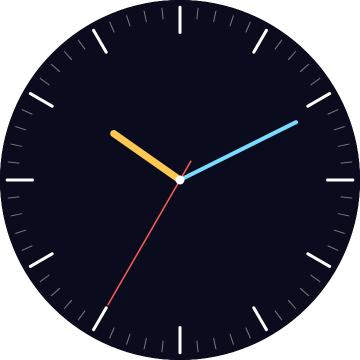
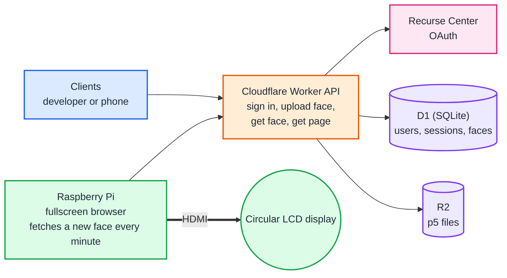

# Clock

A Cloudflare Worker API that stores circular p5.js clock faces, plus a Raspberry Pi that shows them on a round LCD display over HDMI.

**Live at https://clock.recurse.com/** (display page: https://clock.recurse.com/display)

## Architecture

One Worker, and it is only an API: sign in, upload a face, fetch a face, fetch the page. The Raspberry Pi is a thin display. Its browser asks the API for a new face every minute. Clock is the theme, but a face can be any circular p5.js sketch.

Sign-in uses Recurse Center OAuth through Better Auth, the same setup as Batchmate. Data model and open questions are in the [design doc](docs/design.md).

> **A note on names:** this is a round **LCD** display, not LED. The Worker, D1 database, R2 bucket and npm package are named `circular-led-*` by mistake. They keep those names for now, because renaming them would change the deployed Worker. Everywhere else, it is LCD.

## Docs

- [Writing a face](docs/faces.md): the editor, who can do what, and the `face` object your sketch reads.
- [Run it locally](docs/local-development.md): set up and test on your own machine, no accounts needed.
- [Deploying](docs/deploying.md): the Cloudflare account rules and the GitHub Actions deploy.
- [Recurse sign-in](docs/sign-in.md): registering the OAuth app, and how sign-in works.
- [Design](docs/design.md): data model, decisions, open questions, and what each piece does.
- [Third-party code](docs/third-party.md): p5.js and its license.
- [TODO](docs/todo.md): what is left to do.
- [Cloudflare setup script](docs/setup-script.md)
- Rules for coding assistants: [CLAUDE.md](CLAUDE.md)

## Made by

[redSlug](https://github.com/redSlug) and [fcjr](https://github.com/fcjr).

## License

[MIT](LICENSE). The vendored p5.js is LGPL-2.1, see [third-party code](docs/third-party.md).
