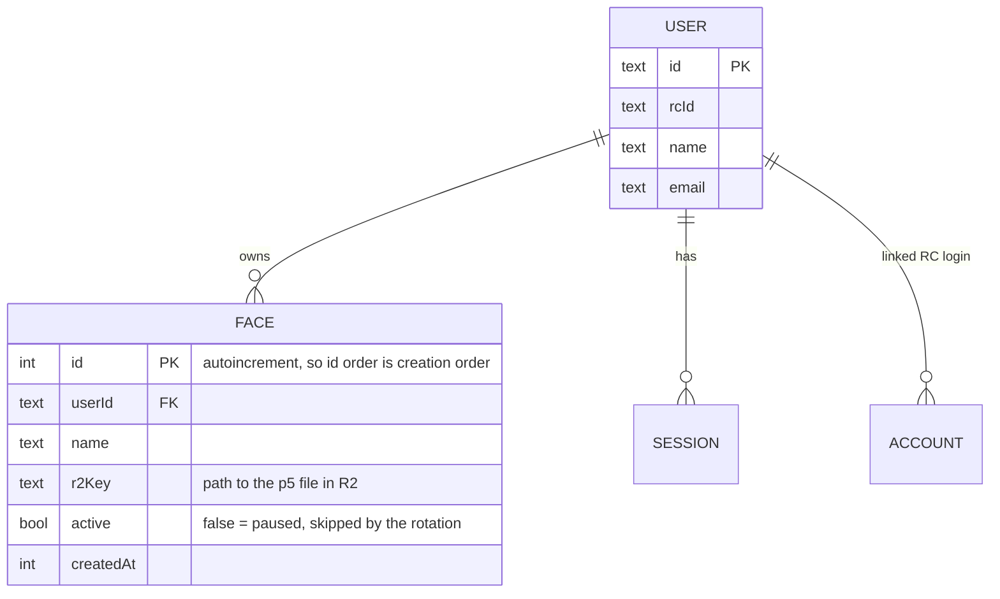
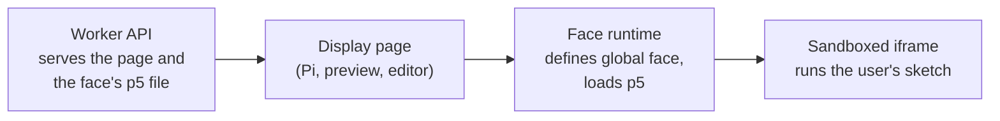

# Design

Work in progress. Sections are stubs while we are still deciding.

## Decisions

| Question | Decision |
| --- | --- |
| How does the Pi read faces? | Public read endpoint. No login or token on the Pi. Only uploading needs sign-in. |
| Which face next? | Next in order. The Pi sends the id it just showed. |
| Who can upload? | Any signed-in RC person. Faces run in a sandboxed iframe. |
| Who can edit a face? | Only its owner. Anyone can open it in the editor and save their own copy. |
| Who can pause or delete a face? | Any signed-in RC person, for any face. Pause hides it from the rotation without deleting it. Delete is permanent. |
| Phone client | Mobile web page. Plain Better Auth cookies, no Expo plugin. |
| Where does rotation happen? | Front end, every minute. |
| Where does data live? | D1 (SQLite) for users, sessions and faces. R2 for the p5 files. |

Consequence of the public read endpoint: anyone who finds the URL can read faces, so don't put anything private in a face.

## Auth

Decision so far: sign in with **Recurse Center OAuth**, using **Better Auth** with the full auth flow, the same approach as [Batchmate](https://github.com/rc-batchmates/batchmate-app).

The full sign-in sequence is in the [README](../README.md#how-sign-in-works-modeled-on-batchmate).

### Notes from Batchmate

Source: `packages/auth/src/index.ts` in the Batchmate repo.

- `better-auth` with the `genericOAuth` plugin, provider id `recurse`.
- RC endpoints: authorize `https://www.recurse.com/oauth/authorize`, token `https://www.recurse.com/oauth/token`, user info `https://www.recurse.com/api/v1/profiles/me`.
- Needs an RC OAuth app: `RC_CLIENT_ID` and `RC_CLIENT_SECRET`, plus `BETTER_AUTH_SECRET` and a `BASE_URL`.
- `mapProfileToUser` copies name, email, image, and RC id from the RC profile onto the user.
- `basePath` is `/api/v1/auth`; `trustedOrigins` lists the allowed web origins (and `localhost` for dev).
- Storage is Drizzle with SQLite on Cloudflare D1, which is also our likely setup. Better Auth generates the auth schema.
- The session is Better Auth's own cookie (`better-auth.session_token`), not an RC token. Each API request calls `auth.api.getSession(headers)`; no session means the user is treated as signed out.
- The RC access and refresh tokens are stored in the `account` table (`providerId = "recurse"`). Batchmate refreshes the RC token when it is within 5 minutes of expiring, only so it can call the RC API on the user's behalf. We may not need that part.
- Tables Better Auth uses: `user`, `session`, `account`, `verification`.
- Batchmate has two RC OAuth apps (one per host), because RC does not allow editing redirect URIs on an existing app. Expect to register a new RC OAuth app with our own callback URL.
- Batchmate also uses the `expo()` plugin for its mobile app. That matters only if we build a native phone client.
- Batchmate has a `databaseHooks.user.create.before` hook that provisions a door-access user. We don't need that part.

### Code vs tokens

Three different credentials appear in the sign-in flow. Two come from Recurse and one from us.

| | Authorization code | RC access token (+ refresh token) | Better Auth session |
| --- | --- | --- | --- |
| Issued by | Recurse | Recurse | Our server (Better Auth) |
| Travels | Through the browser, in the redirect URL (`?code=...&state=...`) | Server to server only. Never reaches the client. | Client holds it as a cookie (phone: SecureStore) |
| Lifetime | One use, very short | Expires; refreshed with the refresh token | Our session expiry |
| Worth on its own | Nothing. Useless without our client secret and PKCE `code_verifier`. | Lets the server call RC's API as that user | Proves to our API who the user is |
| Used for | Exchanged for the RC token at `/oauth/token` | Fetching the profile at `/profiles/me` | Authorizing every request, such as sending a sketch |

Why the extra hop: the code travels through the browser, which is not trusted. The exchange happens server to server with the client secret, so the real RC token never touches the client.

What I verified in the code:
- Batchmate itself only configures the `genericOAuth` provider. The code exchange, state check and session creation are done inside Better Auth (checked against `better-auth` 1.7.15; Batchmate's range is `^1.4.19`).
- PKCE is on by default in the plugin (`pkce ?? true`), and Batchmate does not turn it off. So the authorize request carries a `code_challenge` and the token exchange sends the `code_verifier`. I did not confirm whether RC itself enforces PKCE.
- State and `code_verifier` are saved server-side with a 10 minute expiry. The default store is the database `verification` table. A cookie store is an option.
- The session cookie is set by Better Auth after the user and `account` rows are written. Batchmate has no code of its own for this.

### Open questions

Auth:
- We need our own RC OAuth app, with a callback on the Worker's URL.

Display and API (not decided yet):
- Sandboxing: any signed-in RC person can upload, so a face must run in a sandboxed iframe. Exactly what the sandbox allows is open.
- What does the Pi show when the network or Worker is down? Keep the last face, or a built-in default clock.
- Does the preview match the display exactly? The shared face runtime is meant to make sure it does. See Face contract.

## Faces and rotation

Status: first idea, not final.

### Data

D1 (SQLite) holds users and face metadata. The p5 source code lives in R2. The faces table stores only the path to the R2 object.

`USER`, `SESSION` and `ACCOUNT` are the Better Auth tables (see Auth). `FACE` is ours. Implemented in `src/schema.ts`.

### Rotation

Rotation happens on the front end. The page running in the Pi's browser asks the API for a new face every minute and swaps to it. The API just answers "give me a face"; it does not keep track of what is on screen.

Decided: **next in order**, skipping paused faces. The Pi tells the API the id of the face it just showed, and the API returns the face after it, wrapping back to the first at the end. The Pi starts with no id and gets the first face.

Edge cases (implemented):
- The face the Pi just showed was deleted: return the next face with a larger id (ids only grow, so id order is creation order).
- No faces yet: return nothing and the Pi keeps showing a built-in default.

Not decided yet:
- What the Pi shows if a fetch fails (keep the current face is the obvious answer).

## Face contract

How a face gets time and size. The published version for authors is in the [README](../README.md#writing-a-face). This section is the thinking behind it. Status: proposal.

### Why not just use p5's `hour()` and `minute()`?

They work, and a face may still use them. But a published `face` object is better for these reasons:
- **Override:** the host can set any time, so the editor can show "6 p.m." or scrub a slider, and we can test faces without waiting.
- **Same everywhere:** preview, editor and Pi all use one runtime, so they cannot disagree.
- **Less math for authors:** the hand angles are done for them. Getting 0 at 12 o'clock and clockwise right is the part people get wrong.
- **Timezone is ours to control**, instead of whatever the Pi's OS says.

### Where the logic goes

One small script, the **face runtime**, served by the Worker API with the display page. It is the only place the logic lives.

Order inside the sandboxed iframe: load p5, then the face runtime, then the user's sketch. The runtime defines `window.face` before the sketch runs.

### How `face` works

- `face` uses getters, so no update loop is needed. Each read computes from `now()`.
- `now()` is `Date.now()` unless the host has set an override. The editor sets the override with `postMessage`. The Pi page never sets one.
- Hours, minutes and seconds come from the date in a chosen timezone. Default is the browser's. An optional `?tz=America/New_York` on the page is the likely way to fix the Pi's timezone, so it does not depend on the Pi's OS setting.
- Angles, all in radians, with 0 at 12 o'clock going clockwise:
  - second: `(s + ms/1000) / 60 * TAU`
  - minute: `(m + s/60) / 60 * TAU`
  - hour: `((h % 12) + m/60) / 12 * TAU`
- In p5, `rotate()` with a positive angle is clockwise, so authors rotate by the angle and draw a line straight up (`line(0, 0, 0, -length)`). The README example does this.
- `face.size` is a fixed number, such as 720, chosen once and used for the preview, editor and Pi.

### Decisions for this proposal

- Time is optional for a face. A face may ignore `face` entirely.
- `face` is a global, not a function the face must define. A face is plain p5 with `setup()` and `draw()`.
- Angles are provided, so authors don't redo the hand math.

### Open

- Fixed `face.size`: which number? Depends on the actual LED display resolution.
- Do we also offer `face.millis` or a `face.date` for faces that show the date?
- Should faces be allowed to call `fetch()`? In a public read endpoint, a face that can call out can load other sites. Default plan: the sandbox blocks network access.
- Does the runtime wait for p5 to finish loading, or does the page? Not decided.
- Do faces that don't use the `face` object still need `createCanvas(face.size, ...)`? Probably they should call it with `face.size` too, or the host can do it for them. Not decided.

## Moderation

Any signed-in person can pause, resume or delete any face. That was a deliberate choice for a small, trusted community. The risk is that anyone can remove someone else's work, and deleting is permanent (the R2 file is removed too). Pausing is the gentle option: it hides the face from the display but keeps it. If this becomes a problem, options are soft delete, an owner-or-admin rule, or an audit log. Not built yet.

## Ideas (later phases)

Not designed yet. These are parked here so we don't lose them.

### Draw on your phone

Someone draws on their phone, for example a happy face, and the drawing becomes p5.js source code that is uploaded as a face. They see their own drawing show up on the LED display.

Things to think through later:
- How a drawing becomes p5 code: record strokes as points and generate `line()` or `curve()` calls, or save the drawing as an image or SVG and wrap it in a small sketch.
- It should reuse the normal upload path, so a drawn face is just another face in R2 and D1.
- Fitting a drawing to a round canvas: clipping, and the safe area near the edge.
- Whether a drawing is a still or replays the strokes as an animation, so people see themselves drawing it.
- Whether drawn faces are mixed in with clock faces or get their own rotation.

### Live editor (WYSIWYG)

**Built first version** at `/editor`: code on one side, live round preview on the other, working starter code for a new face, a test-time box, and Save (new face, or update your own). It uses the same sandbox and runtime as the display, so the preview matches. Still open from the list below: marking what a square canvas loses at the edge, and better phone layout.

Original notes:
- The preview must render the same way as the Pi: same sandboxed iframe, same canvas size, same p5 version. This is the "does the preview match the display" open question above. If they differ, the editor is misleading.
- Include a time control (a slider or a text box) that sets the override on `face`, so authors can check any time, such as 10:10 or 6 p.m.
- Run the code on every edit (debounced), and show errors from the sketch instead of a blank circle.
- Mark the round edge of the display, so people see what gets cut off from a square canvas.
- Save goes through the normal upload path (R2 file plus D1 row), so a face written in the editor is just another face.
- Works on a phone too, since phones are a client. A split view may need to stack top and bottom on a small screen.
- Could be the first thing built after the core, since it reuses the preview and sandbox. Ordering is not decided.
