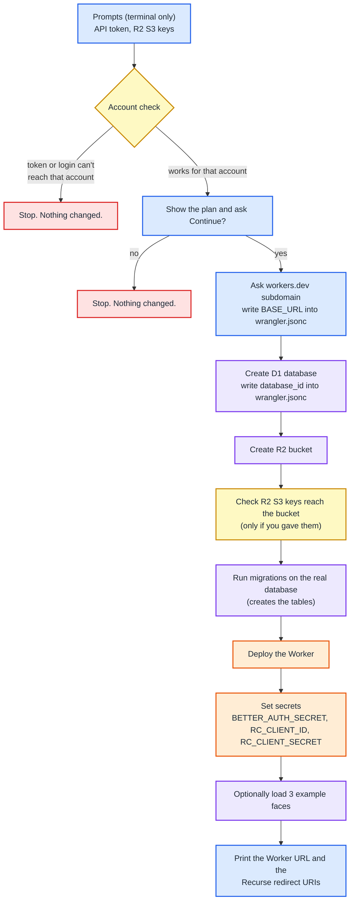

# Cloudflare setup script

`npm run setup:cloudflare` (runs `scripts/setup-cloudflare.sh`) does the one-time Cloudflare setup for this project. Read this page first. Nothing here has been run against your account yet.

The script has no account ID built in. It reads the account from the `account_id` line in `wrangler.jsonc`. If that line is missing it uses `CLOUDFLARE_ACCOUNT_ID`, and if that is missing too it asks you to type it. If the file and the variable both exist and differ, the script stops. It prints the account ID before doing anything, and the "Continue?" question repeats it, so check it is the account you mean.

## What it does



## Step by step

| # | Step | Where it changes things |
| --- | --- | --- |
| 1 | Account check. With a token: lists D1 in the new account. Without: `wrangler whoami` must list that account. | Nothing changed. |
| | Shows the plan and asks **Continue?** | Nothing changed. |
| 2 | If `BASE_URL` in `wrangler.jsonc` is already a real address that is not workers.dev (for example `https://clock.recurse.com`), keeps it. Otherwise asks the workers.dev subdomain and sets `BASE_URL` to `https://circular-led-server.<subdomain>.workers.dev`. | Local file `wrangler.jsonc`, only in the second case. |
| 3 | Finds or creates D1 database `circular-led-server`, writes its id into `wrangler.jsonc`. | Cloudflare (new database), and `wrangler.jsonc`. |
| 4 | Finds or creates R2 bucket `circular-led-faces`. | Cloudflare (new bucket). |
| 4b | If you gave R2 S3 keys and the `aws` CLI is installed, checks they can list the bucket. | Read only. |
| 5 | Applies `migrations/0000_*.sql` to the real database. | Cloudflare (tables created). |
| 6 | `wrangler deploy`. Publishes the Worker and the `public/` pages. | Cloudflare (Worker created). |
| 7 | Sets `BETTER_AUTH_SECRET` (random, generated for you, never shown) unless already set. Sets the Recurse ID and secret if you give them. | Cloudflare (Worker secrets). |
| 8 | Optional: uploads `seed/faces/*.js` to R2 and adds rows to the database. Uses the S3 API if you gave keys, otherwise wrangler. | Cloudflare (data). |
| 9 | Prints the Worker URL, the display page URL, and the two Recurse redirect URIs. | Nothing changed. |

Safe to re-run: it skips a database, bucket or secret that already exists.

## What it never does

- It does not commit or push anything to git. You review `git diff wrangler.jsonc` afterward.
- It does not print or save secrets. Hidden prompts are piped straight to wrangler. The secrets are not written into the project.
- It does not touch any account other than the one it prints at the start. Every wrangler call it makes is pinned to that account through `CLOUDFLARE_ACCOUNT_ID`.

## What it needs

| Value | Required? | Notes |
| --- | --- | --- |
| Cloudflare account ID | Yes | Read from `wrangler.jsonc` `account_id` (or `CLOUDFLARE_ACCOUNT_ID`, or asked if neither exists). |
| Cloudflare access | Yes | Either `wrangler login` as the new account (you are already logged in), or an API token with Workers Scripts, D1 and R2 edit on that account only. |
| workers.dev subdomain | Only if `BASE_URL` is not already set to a custom address | The part before `.workers.dev`. |
| R2 Access Key ID, Secret Access Key, S3 endpoint | No | Give all three or none. The endpoint must be `https://<that account id>.r2.cloudflarestorage.com` (an `.eu.` variant is also accepted). These cannot create the database or deploy. They only read and write objects. |
| Recurse client ID and secret | No | Skip if the Recurse app isn't made yet. Add later with `npx wrangler secret put`. |
| `BETTER_AUTH_SECRET` | No | Generated if you don't give one. |

## Example runs

**Simplest. Answer the prompts. Nothing to type in advance.** Use a separate Terminal window so the hidden prompts work.

```sh
cd /Users/bd/Development/clock
npm run setup:cloudflare
```

Prompts, in order:

| Prompt | Answer |
| --- | --- |
| Cloudflare API token (hidden) | Enter (wrangler is already logged in) |
| R2 S3 Access Key ID | paste it, or Enter to skip |
| R2 S3 Secret Access Key (hidden) | paste it |
| R2 S3 endpoint | Enter for the default |
| Continue? | `y` |
| Subdomain | e.g. `my-subdomain` |
| Set the Recurse client ID and secret now? | `n` for now |
| Load the 3 example faces? | `y` |

**Passing values as environment variables.** No env file. The secret is read hidden, so it never lands in your shell history:

```sh
export WORKERS_SUBDOMAIN="my-subdomain"
export R2_ACCESS_KEY_ID="<access key id>"
export R2_S3_ENDPOINT="https://<account id>.r2.cloudflarestorage.com"
read -rs -p "R2 secret access key: " R2_SECRET_ACCESS_KEY; echo; export R2_SECRET_ACCESS_KEY
npm run setup:cloudflare
```

Add `-- --yes` to skip the "Continue?" and seed questions (the account check still runs). Then close the Terminal tab, or run `unset R2_SECRET_ACCESS_KEY`.

```sh
npm run setup:cloudflare -- --yes
```

**With an API token instead of `wrangler login`.** Use the same hidden-read pattern:

```sh
read -rs -p "Cloudflare API token: " CLOUDFLARE_API_TOKEN; echo; export CLOUDFLARE_API_TOKEN
npm run setup:cloudflare
```

## Afterward

1. `git diff wrangler.jsonc` shows two changed values: `database_id` and `BASE_URL`.
2. Register the Recurse OAuth app with the two redirect URIs the script prints.
3. Set the Recurse secrets: `npx wrangler secret put RC_CLIENT_ID` and `RC_CLIENT_SECRET`.
4. Commit and push, so the GitHub-connected build has the real IDs.
5. Open `<Worker URL>/display` to see the display page.

## What is tested, and what is not

Tested without touching Cloudflare: the script's syntax, the guards (bad env file, env file inside the repo, partial R2 keys, wrong-account endpoint, lookalike hostname), the prompt order in a real terminal session, and the `wrangler.jsonc` edits on a copy.

**Not tested:** steps 3 to 8 against the real account (create, migrate, deploy, secrets, S3 upload). The first real run is the first test of those.
