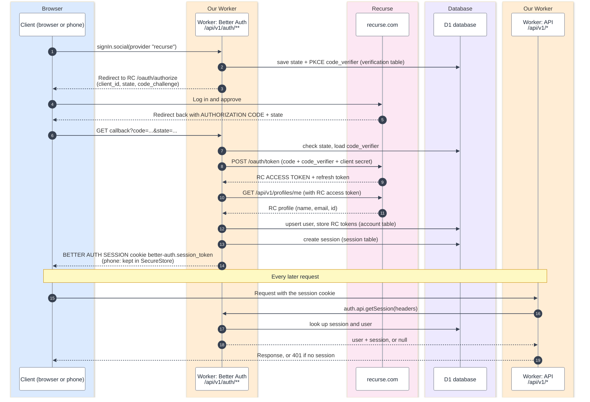

# Setting up Recurse sign-in

How we did it. Do this once, after the Worker is deployed and you know its URL.

1. Go to https://www.recurse.com/settings/apps and create a new OAuth app. Name it something like "Circular LCD".
2. Register the redirect URIs. **Recurse does not let you edit them afterward**, so get them right first. The app is served through a proxy at `clock.recurse.com`, and `BASE_URL` in `wrangler.jsonc` is that public address. Sign-in redirects there, so register `BASE_URL` plus the path `/api/v1/auth/callback/recurse`, with no trailing slash:
   - `https://clock.recurse.com/api/v1/auth/callback/recurse`
   - `http://localhost:8787/api/v1/auth/callback/recurse` (for local development; add it only if the form takes more than one)
3. Save the app and copy the **client ID** and **client secret**.
4. Give them to the Worker as secrets. Either answer `y` when `npm run setup:cloudflare` asks, or run these in your own terminal and paste at the prompts (the secret is hidden):
   ```sh
   npx wrangler secret put RC_CLIENT_ID
   npx wrangler secret put RC_CLIENT_SECRET
   ```
5. Check it: open the Worker's home page and click "Sign in with Recurse".

Notes:
- Sign-in returns an error (HTTP 500) until both secrets exist. That is expected before this step.
- The secrets live in Cloudflare only. Never put them in the repo, `.dev.vars.example`, or chat.
- Local development does not need real Recurse credentials. It uses a fake Recurse server (`npm run mock-rc`).
- If you ever change the public address, you need a new Recurse app, because the redirect URI is fixed at creation. An app registered for the old workers.dev address will not work once `BASE_URL` is `https://clock.recurse.com`.
- Pages opened on the direct workers.dev address redirect to `BASE_URL` (`public/redirect.js`). Sign-in must start on the same host it returns to, because the OAuth state cookie only travels to the host that set it. Starting on workers.dev and finishing on clock.recurse.com fails with `state_mismatch`.

## How sign-in works (modeled on Batchmate)

Recurse never hands the client a session token. Recurse issues an OAuth access token to the server, and Better Auth creates its own session and gives the client that.



Three different credentials show up in this flow. They are not interchangeable. See [Code vs tokens](design.md#code-vs-tokens).
